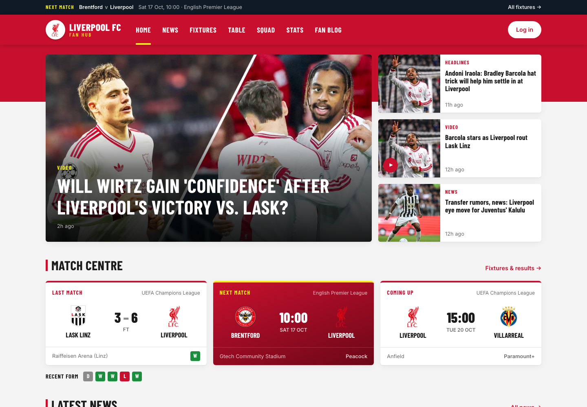
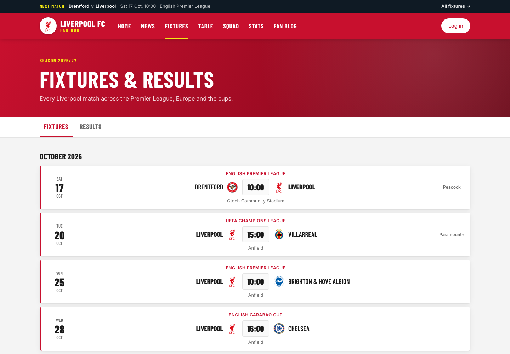
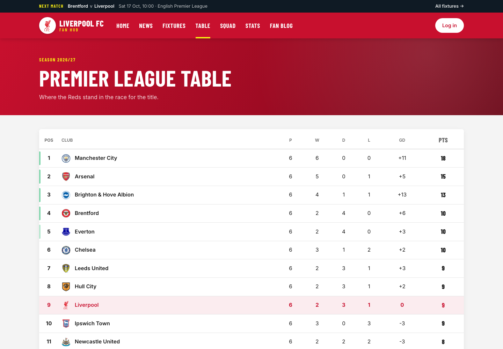
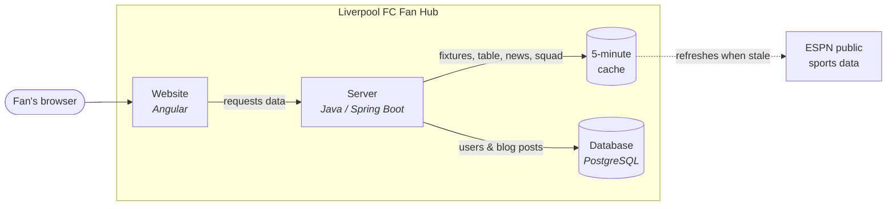
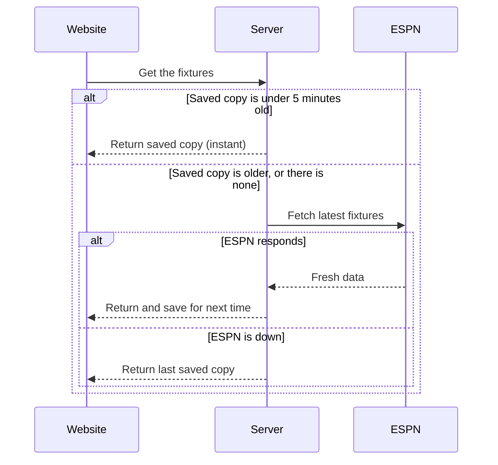
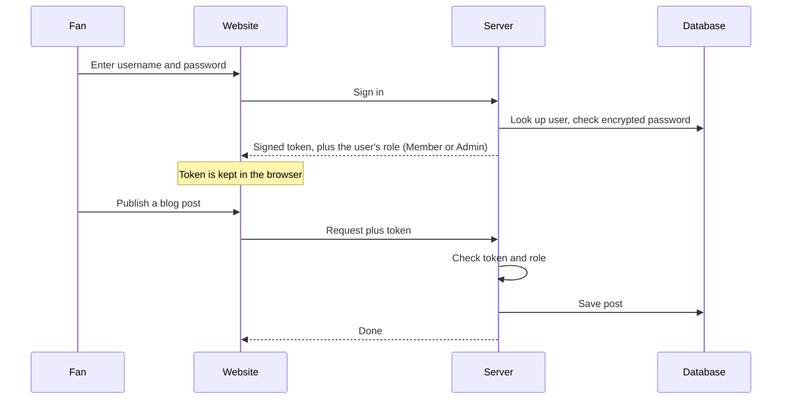
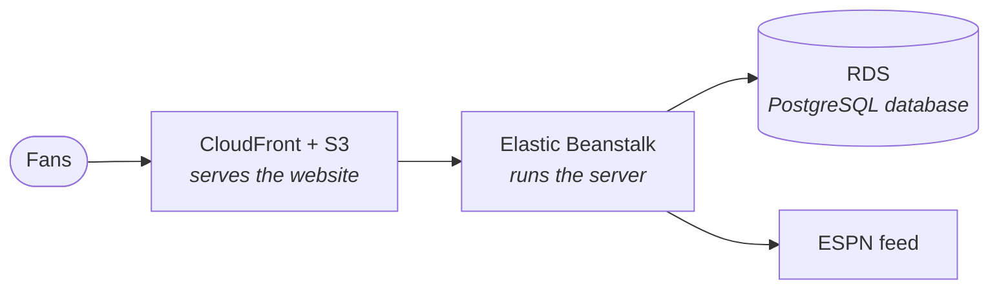

# Liverpool FC Fan Hub

A full-stack web app for Liverpool FC supporters. It shows **live** fixtures, results, the Premier League table, the squad and the latest news, alongside a fan blog that signed-in members can write for.

**Built with:** Angular · TypeScript · Java · Spring Boot · PostgreSQL · Docker · AWS-ready



| Fixtures & results | League table |
| --- | --- |
|  |  |

## What it does

- **Live match centre:** last result, next matches, recent form, and kick-off times shown in your own time zone
- **Fixtures, results and league table:** every competition, kept up to date automatically
- **Squad and stats:** the first team by position, the season record, and the league's top scorers with Liverpool players highlighted
- **News:** the latest Liverpool headlines and match reports
- **Fan blog:** posts stored in the app's own database; members can publish and admins can moderate
- **Works on any screen:** laptop, tablet and phone

## How it works

The app has three parts: the **website** people see, a **server** that handles logins and data, and a **database** that stores users and blog posts. Live football data comes from ESPN's free public sports feed.



| Part | Responsibility |
| --- | --- |
| **Website** (Angular) | Pages, navigation and layout. Sends every data request to the server. |
| **Server** (Spring Boot) | Logins and permissions, blog features, and fetching live football data. |
| **Database** (PostgreSQL) | User accounts, roles and blog posts. |
| **ESPN feed** | Fixtures, results, the table, the squad, news and player stats. Free, no API key. |

### Live data: fast and resilient

The server sits between the website and ESPN instead of letting browsers call ESPN directly. That's needed because ESPN blocks direct browser requests, and it has two side benefits: pages load faster, and the site keeps working when ESPN has a hiccup.



### Logins and permissions

Passwords are stored encrypted. After signing in, the browser holds a secure token (a JWT) that proves who the user is. It sends this token only to our own server, never to outside sites.



**Roles:** anyone can browse, members can write blog posts, and admins can also delete posts and manage stored fixtures and stats.

### Hosting

**Locally**, one command runs everything in Docker. **In the cloud**, the project is set up for AWS:



## Run it locally

You only need [Docker Desktop](https://www.docker.com/products/docker-desktop/).

```bash
git clone https://github.com/A-Ighalo/Liverpool-FC-Blog-WebApp.git
cd Liverpool-FC-Blog-WebApp
docker compose up -d
```

Open **http://localhost:4200**. The first start takes a few minutes while dependencies download. Stop everything with `docker compose down`.

<details>
<summary>Running without Docker, creating an admin, and API endpoints</summary>

**Without Docker** you need Java 17, Maven, Node.js 20.19+ and PostgreSQL. Create a database called `liverpool_fc_db`, then:

```bash
cd backend && mvn spring-boot:run          # terminal 1: server on http://localhost:8080
cd frontend && npm install && npm start     # terminal 2: website on http://localhost:4200
```

**Make an account an admin.** New accounts start as members:

```bash
curl -X POST http://localhost:8080/api/auth/signup -H "Content-Type: application/json" \
  -d '{"username":"admin","email":"admin@example.com","password":"changeme123"}'

docker compose exec db psql -U postgres -d liverpool_fc_db -c \
  "INSERT INTO user_roles (user_id, roles) SELECT id, 'ADMIN' FROM users WHERE username = 'admin';"
```

**Main API endpoints** (all under `/api`):

| Area | Endpoints |
| --- | --- |
| Accounts | `POST /auth/signup`, `POST /auth/signin` |
| Live data | `GET /live/public/fixtures`, `/results`, `/table`, `/news`, `/squad`, `/leaders` |
| Blog | `GET /blog/public/posts`, `/public/posts/{id}`, `/public/posts/search`; `POST /blog/posts`, `PUT /blog/posts/{id}` (members); `DELETE /blog/posts/{id}` (admins) |
| Stored fixtures and stats | `GET /fixtures/public/...`, `GET /stats/public/...`; create, update and delete are admin-only |

**Tests:** `cd backend && mvn test`, `cd frontend && npm test`

</details>

## Project layout

```
backend/    Java server: logins, blog, live-data proxy
frontend/   Angular website: pages, styling, data services
aws/        Cloud hosting configuration
docs/       Screenshots
docker-compose.yml   Runs the whole app locally
```

## Roadmap

- Sign-up page and blog editor in the website (both work through the API today)
- Full admin dashboard (currently a placeholder)
- Configurable server address for cloud deployment (currently set to `localhost`)
- Broader automated test coverage

---

*An unofficial fan project, not affiliated with Liverpool Football Club. Match data courtesy of ESPN.*
